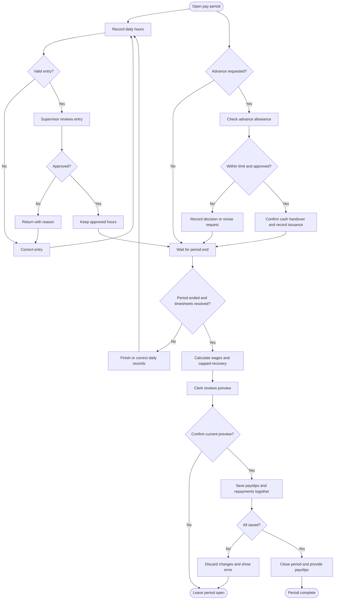
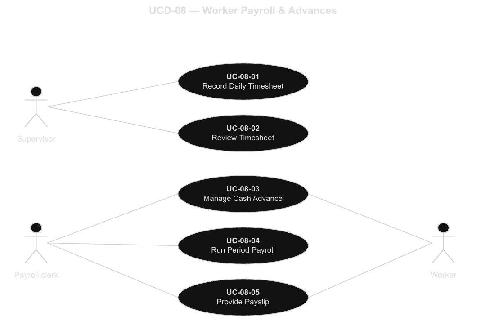
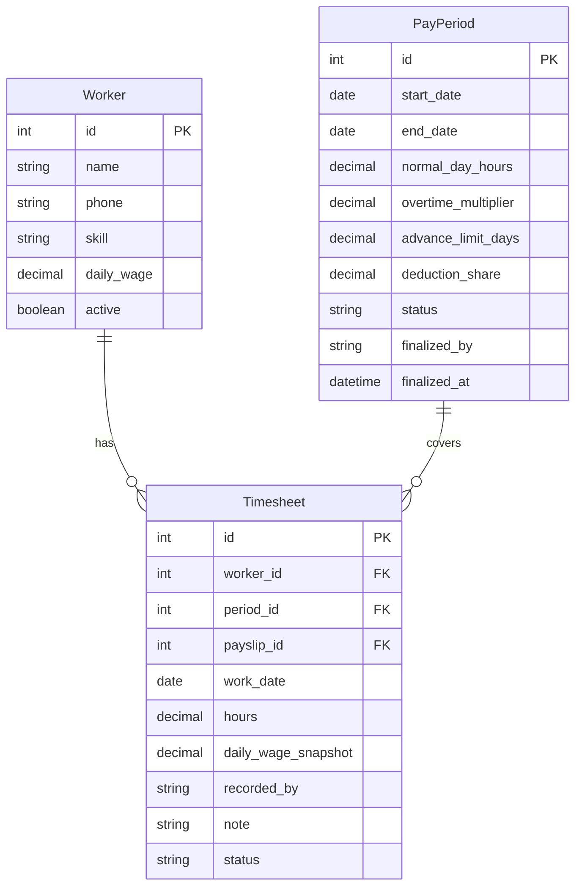
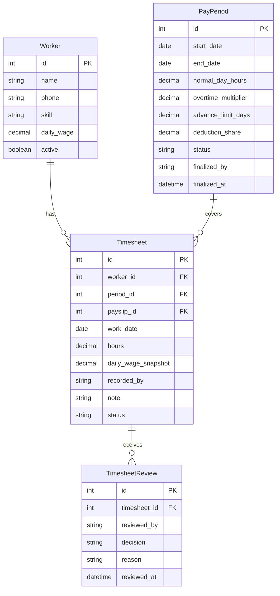
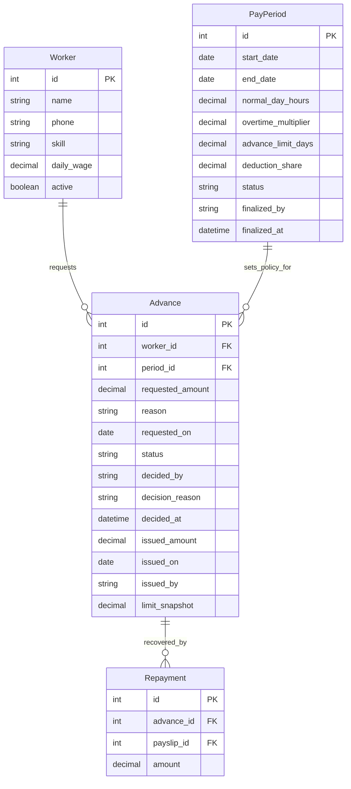
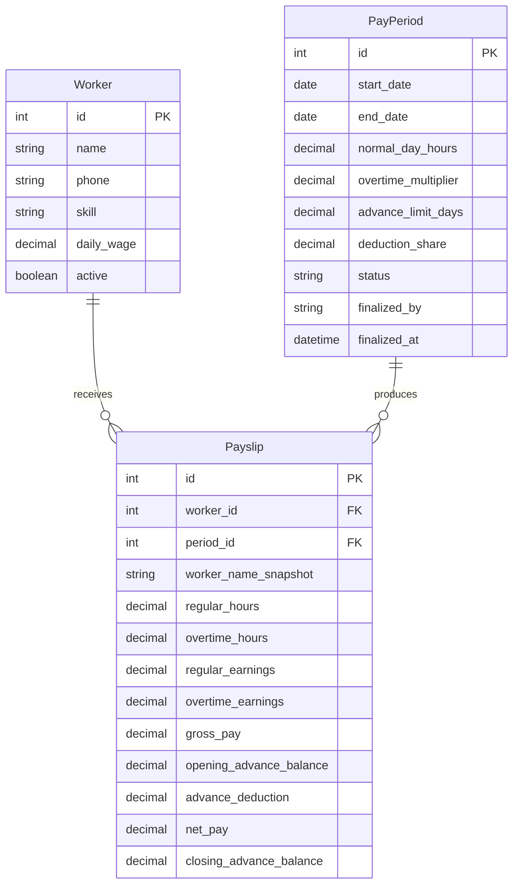
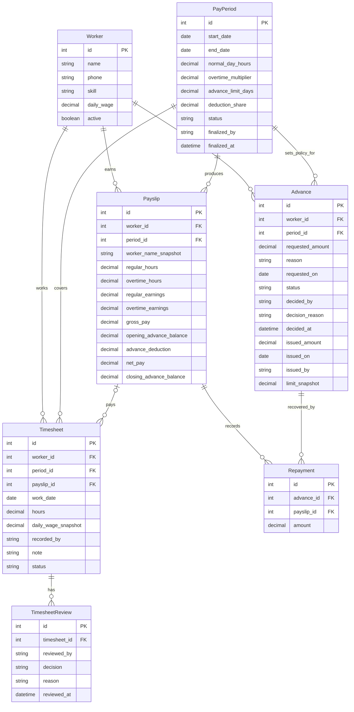
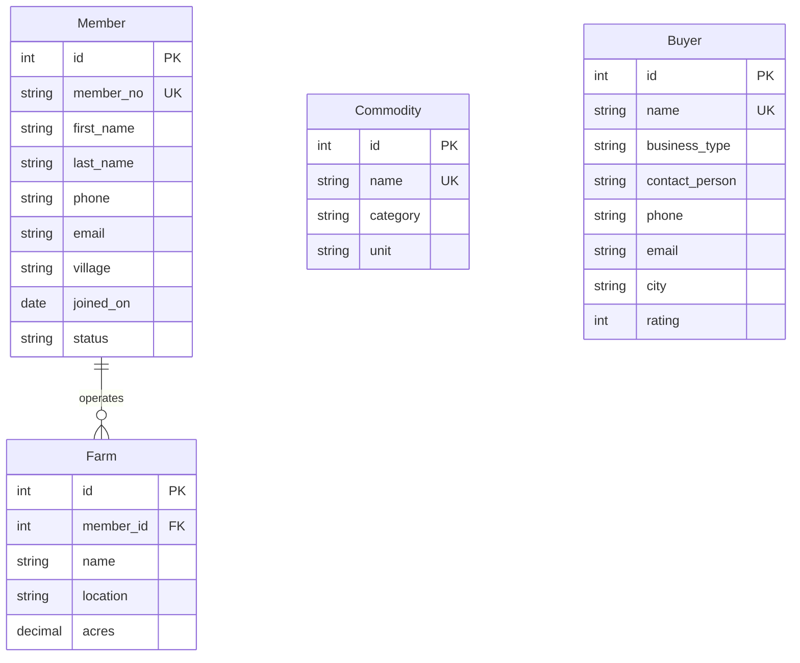

# Requirements

## 1. Project statement

### 1.1 Background and business problem

AgriConnect is a farmer-services cooperative that pays seasonal workers from daily timesheets. Supervisors record hours, and approved work becomes the basis for calculating wages. Workers may also request cash advances before payday. These advances must be limited and recovered from later earnings without taking more than the permitted share of a worker's payslip.

The business problem is coordinating these activities accurately. Recording hours is different from approving them for payment. The payroll clerk needs to distinguish approved entries from records that still require review, calculate overtime consistently, and avoid paying for the same work twice. When a worker has an advance, the clerk must also know the amount still owed and the maximum deduction allowed for that pay period.

The proposed Worker Payroll & Advances application brings these connected activities into one business workflow. It supports recording and approving daily work, handling advance requests, calculating period wages, and producing payslips. It connects to the existing AgriConnect Worker records instead of introducing a separate worker registry. The intended result is a payroll record that the supervisor, clerk, and worker can understand and check.

This Phase I statement focuses on uses, processes, information, and business rules. It does not describe programming, deployment, or database installation. The requirements and diagrams establish what the application should do before its implementation begins.

### 1.2 Goals and objectives

The first objective is to pay workers accurately for approved work. Every finalized payslip should be supported by the daily timesheets used in its calculation. Pending or returned timesheets must not contribute wages, and the same approved timesheet must never be included in two finalized payslips. Supervisors should be able to resolve errors before the payroll clerk completes a pay period.

The second objective is consistent overtime calculation. Hours beyond the normal working day must receive the overtime rate. The system should display normal and overtime hours separately so that both the worker and the clerk can understand how the earnings were calculated. The exact normal-day length and overtime rate are not specified in the client brief and must be confirmed.

The third objective is fair advance recovery. The system should check a worker's existing debt before a new advance is issued. When payroll is calculated, the deduction must remain within the permitted share of the payslip. Any unpaid advance balance should carry forward rather than disappear or produce an excessive deduction. A worker with no earnings should have no advance recovery from that period's payslip.

The fourth objective is understandable output. A clerk needs a payroll run summary with totals for the period, while a worker needs an individual payslip explaining earnings, deductions, and net pay. An advance record must show whether money was merely requested, approved, or actually issued. These distinctions prevent an approved request from being incorrectly treated as cash already received.

Success will be evaluated using concrete scenarios: an unapproved entry receives no wages; a day with overtime receives the correct earnings; an excessive advance is refused; a deduction does not exceed its ceiling; and repeated payroll finalization does not duplicate payslips or repayments. These are intended acceptance conditions, not claims that an application has already been implemented.

### 1.3 Actors, stakeholders, and responsibilities

The **supervisor** records the hours a worker completes each day. The supervisor also reviews pending timesheets and either approves them or returns them with a correction reason. A returned entry can be corrected and submitted for review again while its period is open. The brief does not require a second supervisor to approve an entry, so this draft does not impose that separation without client confirmation.

The **payroll clerk** handles advance requests on behalf of workers, records decisions and cash issuance, and prepares period payroll. The clerk reviews a preview before finalizing it. The clerk also retrieves payslips and explains their amounts using the underlying hours, earnings, and advance deductions. Actual cash handover happens outside the application; the clerk records that it occurred.

The **worker** requests an advance and receives the decision and any issued cash. The worker also receives or reviews a payslip. In this proposed workflow, the clerk enters advance information and retrieves payslips on the worker's behalf. Workers therefore remain business actors without requiring a worker login feature during Phase I.

Cooperative management is a stakeholder because it needs consistent payroll practices and reliable totals. Management supplies the approved pay calendar and policy values. It is not modeled as an application actor in this scope because the five operational processes do not require a separate management interaction.

### 1.4 Scope and shared-core integration

The application covers daily timesheet recording and correction, timesheet review, advance requests and issuance records, payroll calculation and finalization, and payslip retrieval. The payroll run summary is an output of running payroll. Advance balances are calculated from issued advances and recorded payroll repayments rather than maintained as unrelated totals.

The application uses the existing **Worker** entity from A3. It preserves the identifier `Worker.id` and the attributes `name`, `phone`, `skill`, `daily_wage`, and `active`. A worker does not have to be a cooperative member. The worker's daily wage supplies the wage basis, while the proposed payroll records retain the value used for historical calculations.

Member, Farm, Commodity, and Buyer remain existing shared-core entities. The combined model preserves their identities and the existing Member–Farm relationship. No unnecessary payroll relationships are invented: the brief does not ask for allocating wages by farm, crop, buyer, or member. Worker is the direct integration point for this topic.

The topic brief explicitly excludes bank transfers, tax or statutory deductions, and login/user accounts. This proposal also excludes recruitment, attendance hardware, leave and benefits, interest on advances, and integration with external accounting systems. These features would expand the project beyond the stated payroll problem. A finalized payslip records the calculation of net wages; it is not a receipt proving that those wages have been paid.

Reference worker records, approved pay periods, and policy values are assumed to be available before the operational processes begin. Maintaining those reference records is outside these five use cases. Corrections discovered after finalization require an adjustment process to be agreed with the client; this draft does not allow historical payroll to be silently edited.

### 1.5 Business facts and proposed assumptions

The following business facts are supplied by the cooperative in A2, Topic 08.

| Fact | Requirement | Where addressed |
|---|---|---|
| F1 | Each day a supervisor records a worker's hours; only approved timesheets are paid. | UC-08-01, UC-08-02, UC-08-04 |
| F2 | Hours beyond a normal day are paid at an overtime rate. | UC-08-04 |
| F3 | Advances are limited and deducted from later pay, but never above a set share of a payslip. | UC-08-03, UC-08-04 |
| F4 | Each pay period produces a payslip per worker. | UC-08-04, UC-08-05 |

| ID | Proposed assumption |
|---|---|
| A1 | Use nonoverlapping weekly pay periods. Each period has approved normal-day hours, an overtime multiplier, an advance limit in days of wages, and a deduction share. Freeze policy values once the period has transactions. |
| A2 | Regular hourly rate is daily wage divided by normal-day hours. Partial days are paid proportionally, and overtime is calculated daily. Capture the worker's wage when a timesheet is first entered. |
| A3 | One timesheet represents a worker's total cooperative hours for a date; hours must be greater than zero and no more than 24. |
| A4 | A supervisor approves or returns a Pending entry. Return requires a reason. Corrected entries require review again; Approved entries are locked. |
| A5 | The clerk decides advance requests. Outstanding debt plus the new advance cannot exceed current daily wage multiplied by the advance-limit days. |
| A6 | Approval alone creates no debt. Record an advance as Issued only after cash handover is confirmed, and recheck eligibility and the limit at issuance. |
| A7 | Recover the earliest-issued advance first. Cap the total deduction at a share of gross earnings; carry the rest forward without interest. |
| A8 | Include workers active at finalization, plus workers with timesheets in the period or outstanding advances eligible for that payroll. Give each included worker one payslip, including a zero-earnings payslip when applicable. |
| A9 | Pending or Returned timesheets and earlier unfinished payroll periods block finalization until resolved. Preview changes no records; successful finalization saves all payslips and repayments together and locks the period. |
| A10 | Round daily earning components to the nearest cent, then sum them. Round the deduction ceiling down to a cent so it never exceeds the allowed share. |

Client clarification is needed on the actual policy numbers, pay frequency, approval responsibilities, treatment of partial days, worker eligibility, and corrections to closed periods. The numerical example below illustrates the proposed rules but does not establish client-approved values.

### 1.6 Major functions and business processes

**Record daily work.** The supervisor selects a worker and work date, enters hours and an optional note, and submits the entry. The system locates the applicable open period, checks the hours and worker, and refuses duplicate entries for the same worker and date. A valid submission becomes Pending. The worker's daily wage is captured so future profile changes do not rewrite the wage basis of recorded work.

**Review timesheets.** The supervisor opens the pending list and compares each entry with the work performed. Approval makes it eligible for payroll. Returning it records the reason and keeps it unpaid. The supervisor corrects the returned entry through the recording process and submits it for review again. Review records retain who made each decision and when. An approved entry cannot be edited through the normal correction flow.

**Manage cash advances.** The worker supplies a requested amount and reason to the clerk. The system shows current debt and the available allowance under the advance limit. The clerk approves or rejects the request. When approved cash is handed over, the clerk confirms the issuance. Rejected requests and approved requests that have not been issued do not increase the outstanding balance. A later collection requires a fresh eligibility and limit check.

**Run period payroll.** After the period ends, the clerk requests a preview. The system identifies the worker roster and checks that timesheets have been resolved. It calculates normal and overtime earnings from approved entries, applies capped advance recovery, and presents individual and overall totals. The clerk confirms the current preview. Finalization stores payslips and repayments together, links the paid timesheets to their payslips, and closes the period.

**Provide payslips.** The worker identifies the period they need, and the clerk retrieves the finalized record. The output shows normal and overtime hours, corresponding earnings, gross pay, advance recovery, net pay, and the remaining advance balance after that payroll. Reprinting retrieves the same record without creating another payslip or changing any advance balance.

These functions form one connected process. Timesheet approval controls which hours are eligible, issued advances establish debt, payroll determines recovery, and payslips explain the result. A problem in an earlier step must be resolved rather than hidden by manually changing a final total.

### 1.7 Main inputs, outputs, and information requirements

| Function | Inputs | Outputs |
|---|---|---|
| Record work | Worker, date, hours, supervisor name, optional note | Pending timesheet or validation message |
| Review work | Timesheet selection, reviewer, decision, return reason | Review record and updated timesheet status |
| Manage advance | Worker, amount, reason, clerk decision, cash confirmation, issue date | Advance decision and issuance record; current balance |
| Run payroll | Period selection, roster confirmation, clerk name, finalization confirmation | Payroll preview; finalized run summary; payslips and repayment records |
| Provide payslip | Worker and period selection | Readable finalized payslip or no-result message |

Forms should show the worker's name with the identifier so users can detect a mistaken selection. Dates must fall within the applicable period, amounts must be valid, and required decisions must be recorded. Computed figures should be read-only. Validation messages should explain what needs correction instead of silently accepting or discarding unsuitable information.

The information model must explain how each amount was obtained. Timesheets retain daily hours and the captured wage. Reviews retain decisions and reasons. Advances retain requested amounts, decisions, issued cash, and dates. Repayments link each recovered amount to both its advance and its payslip. The system can then distinguish a request from an actual debt and explain how much of that debt each payroll recovered.

Reports must state their time context. A current advance balance may differ from the balance after last week's payroll. Payslips therefore retain historical opening and closing balances. Previews must be labelled clearly so they are not mistaken for finalized records. The payroll summary totals should agree with the sum of the individual payslips.

### 1.8 Wage and advance calculations

For an approved daily timesheet, let `H` be hours worked, `N` normal-day hours, `W` the captured daily wage, and `M` the overtime multiplier. Proposed calculations are:

- Normal hours = `min(H, N)`; overtime hours = `max(H − N, 0)`.
- Regular hourly rate = `W / N`.
- Regular earnings = normal hours × regular hourly rate.
- Overtime earnings = overtime hours × regular hourly rate × `M`.
- Gross period pay = sum of rounded daily regular and overtime earnings.
- Deduction ceiling = gross pay × deduction share, rounded down to a cent.
- Advance deduction = the lesser of outstanding issued debt and the deduction ceiling.
- Net pay = gross pay − advance deduction.
- Remaining advance balance = opening advance balance − advance deduction.

**Example:** assume an eight-hour normal day, daily wage of 80 currency units, overtime multiplier of 1.5, advance limit of three days' wages, and deduction share of 25%. None of these numeric values is supplied by the brief. A worker completes four approved eight-hour days and one approved ten-hour day. Normal earnings are 400 and overtime earnings are 30, giving gross pay of 430. With outstanding debt of 200, recovery is limited to 107.50. Net pay is 322.50 and remaining debt is 92.50.

Under that example's advance limit, total outstanding debt cannot exceed 240. A worker who already owes 200 has an allowance of 40 for a new advance. A worker with no gross earnings has no deduction that period. If several advances exist, recovery is allocated to the earliest-issued debt first, leaving a partial balance when the deduction ceiling is reached.

### 1.9 Exceptions, controls, and expected benefits

An invalid worker/date selection, duplicate timesheet, invalid hours, or closed period prevents recording. Returning a timesheet keeps it out of payroll until corrected and approved. An excessive advance cannot be approved or issued without revision. A rejected request must have a reason, while an approved but unissued request remains separate from outstanding debt.

Payroll finalization must be repeat-safe. The application must produce one finalized payslip for each included worker and period, link each payable timesheet once, and record each advance repayment once. If the underlying records change after preview, the clerk must obtain a new preview. If any finalization step fails, no partial payslips or deductions should remain.

Historical payroll must remain understandable. A later wage change, worker deactivation, or new advance must not alter an earlier payslip. Related records should be retained instead of deleting the evidence behind financial totals. Recording supervisor and clerk names supports business review, but does not claim to provide authenticated identity when account management is out of scope.

The expected benefit is a consistent process from daily work to the worker's final explanation of pay. Supervisors can see what requires correction, clerks can calculate payroll without re-entering hours, and workers can understand their overtime and advance recovery. The project should be accepted only when the core facts are demonstrated, the forms agree with the data model, and the alternative flows lead to clear correction or stopping points.

## 2. Process flow chart

### PFC-08 — Daily Work, Advances, and Period Payroll

## 3. Actors and Use Case Diagram

| Actor | Role in the process |
|---|---|
| Supervisor | Records daily work, corrects returned entries, approves or returns timesheets. |
| Payroll clerk | Records advance decisions and issuance, runs payroll, provides payslips. |
| Worker | Requests an advance through the clerk and receives the decision; receives payslips. |

| ID | Essential use case | Primary actor | Summary |
|---|---|---|---|
| UC-08-01 | Record Daily Timesheet | Supervisor | Enter daily work or correct a returned entry. |
| UC-08-02 | Review Timesheet | Supervisor | Approve or return recorded hours. |
| UC-08-03 | Manage Cash Advance | Payroll clerk | Record a request, decision, and actual issuance. |
| UC-08-04 | Run Period Payroll | Payroll clerk | Calculate wages and recovery, then finalize payslips. |
| UC-08-05 | Provide Payslip | Payroll clerk | Retrieve and provide a worker's finalized period record. |

### UCD-08 — Worker Payroll & Advances

## 4. Detailed Use Cases and Supporting Designs

### 4.1 Detailed use case — UC-08-01 Record Daily Timesheet

### Use Case Description

| Field | Description |
|---|---|
| Use case name | Record Daily Timesheet |
| ID | UC-08-01 |
| Primary actor | Supervisor |
| Stakeholders & interests | Worker: accurate hours; supervisor: record completed work; payroll clerk: reliable wage inputs. |
| Brief description | Record a worker’s daily hours, or correct a returned entry, and submit it for review. |
| Trigger / type | Day’s work is complete, or a returned entry needs correction. Type: external. |
| Relationships | Association: Supervisor. Include: None. Extend: None. Generalization: None. |
| Preconditions | Worker reference data and the applicable pay period exist. |
| Normal flow of events | 1. Supervisor selects a worker and work date, or opens a returned timesheet. 2. System checks eligibility and whether entry/correction is allowed, and displays the worker and open period. 3. Supervisor enters hours, supervisor name, and an optional note, then submits. 4. System validates the fields and duplicate rule, and shows the wage basis. New entries capture the current daily wage; corrections retain the original wage. 5. Supervisor confirms the displayed entry. 6. System saves the entry as Pending and displays its reference and status. |
| Alternate / exception flows | 2a. Invalid worker/date, new entry for an inactive worker, closed period, or existing entry not Returned: show the reason; use case ends without changes. 4a. Invalid hours, missing required information, or duplicate worker/date: explain the error; return to step 3. 5a. Supervisor cancels: use case ends without changes. 6a. Saving fails or the period closes before saving: retain no changes, display an error; use case ends. |
| Postconditions | Successful entry is Pending with captured wage and supervisor name. A refused or failed submission makes no changes. |
| Business rules | BR-1 Record daily work for F1. BR-2 One record per worker/date, with 0 < hours ≤ 24 (A3). BR-3 Work date is not in the future and belongs to an open period. BR-4 Only Returned entries may be corrected, and need approval again (A4). BR-5 Worker must be active for new entries; an existing returned entry may be corrected after deactivation. |
| Related artefacts | IO-08-01-01; IO-08-01-02; AD-08-01; ERD-08-01 |
| Frequency | Daily during periods with work; exact volume to be confirmed. |

### Input Screen
#### IO-08-01-01 — Daily Timesheet Form 

**Screen/report layout — DAILY TIMESHEET**

| Label | Entry or displayed value |
|---|---|
| Worker | [Select worker] → name shown |
| Work date | [YYYY-MM-DD] |
| Pay period | [Automatically displayed] |
| Hours worked | [Enter hours] |
| Daily wage | [Captured wage — read-only] |
| Supervisor | [Enter name] |
| Note | [Optional explanation] |
| Actions | [Submit] → review → [Confirm] [Cancel] |

**Field mapping**

| Screen / report area | Fields and controls | Data mapping |
|---|---|---|
| Worker and period | Worker selector; read-only name; work date; read-only period | Worker.id/name; Timesheet.worker_id/work_date/period_id |
| Work details | Hours; supervisor name; optional note | Timesheet.hours/recorded_by/note |
| Wage basis | Captured daily wage, read-only | Timesheet.daily_wage_snapshot |
| Actions | Submit → review; Confirm / Cancel | Controls; not stored data |

### Output Screen
#### IO-08-01-02 — Timesheet Submission Result

**Screen/report layout — TIMESHEET SUBMITTED**

| Label | Entry or displayed value |
|---|---|
| Timesheet reference | [Generated ID] |
| Worker / date | [Worker name] / [Work date] |
| Hours | [Recorded hours] |
| Status | Pending |
| Message | Saved; awaiting supervisor review. |

**Field mapping**

| Screen / report area | Fields and controls | Data mapping |
|---|---|---|
| Record | Reference; worker; date; hours; status | Timesheet.id/worker_id/work_date/hours/status; Worker.name |
| Feedback | Saved as Pending, or validation reason | Derived from validation/save outcome |

#### AD-08-01 — Record Daily Timesheet

#### ERD-08-01 — Record Daily Timesheet

### 4.2 Detailed use case — UC-08-02 Review Timesheet

| Template field | Description |
|---|---|
| Use case name | Review Timesheet |
| ID | UC-08-02 |
| Primary actor | Supervisor |
| Stakeholders & interests | Worker: correct wages; supervisor: resolve inaccurate entries; clerk: identify payable work. |
| Brief description | Review a Pending timesheet and approve it or return it for correction. |
| Trigger / type | A Pending entry is available for review. Type: external. |
| Relationships | Association: Supervisor. Include: None. Extend: None. Generalization: None. |
| Preconditions | Timesheets exist; supervisor has work evidence to review. |
| Normal flow of events | 1. Supervisor selects a timesheet from the review list. 2. System checks that it is Pending in an open period and displays its details and review history. 3. Supervisor selects Approve or Return, enters their name, and supplies a reason when returning. 4. System validates the decision and required fields. 5. Supervisor confirms the decision. 6. System stores the review and updates the timesheet status together, then displays the result. |
| Alternate / exception flows | 2a. Entry is no longer Pending or period is closed: show current status; use case ends. 4a. Missing decision, reviewer, or required return reason: display a validation message; return to step 3. 5a. Supervisor cancels: use case ends without changes. 6a. Entry changed during review or saving fails: store neither change, show the error; use case ends. |
| Postconditions | Timesheet becomes Approved or Returned and a review record exists. On failure, neither status nor review changes. |
| Business rules | BR-1 Only Approved entries qualify for wages (F1). BR-2 Review only Pending entries in an open period. BR-3 Return requires a reason (A4). BR-4 Preserve prior decisions when a corrected entry is reviewed again. |
| Related artefacts | IO-08-02-01; IO-08-02-02; AD-08-02; ERD-08-02 |
| Frequency | Daily or before payroll; volume to be confirmed. |

#### IO-08-02-01 — Timesheet Review Form

**Screen/report layout — REVIEW TIMESHEET**

| Label | Entry or displayed value |
|---|---|
| Timesheet | [Select Pending record] |
| Worker / date | [Worker name] / [Work date] |
| Hours / daily wage | [Hours] / [Captured wage] |
| Note / status | [Recorded note] / Pending |
| Previous reviews | [Reviewer, decision, reason, time] |
| Decision | [Approve] or [Return] |
| Reviewer | [Enter name] |
| Reason | [Required when returning] |
| Actions | [Confirm] [Cancel] |

**Field mapping**

| Screen / report area | Fields and controls | Data mapping |
|---|---|---|
| Read-only work | Reference; worker name; date; hours; wage; note; status | Timesheet.id/worker_id/work_date/hours/daily_wage_snapshot/note/status; Worker.name |
| Review history | Reviewer; decision; reason; time | TimesheetReview.reviewed_by/decision/reason/reviewed_at |
| Decision | Approve / Return; reviewer name; reason | TimesheetReview.decision/reviewed_by/reason |
| Actions | Confirm / Cancel | Controls; not stored data |

#### IO-08-02-02 — Timesheet Review Result

**Screen/report layout — REVIEW RESULT**

| Label | Entry or displayed value |
|---|---|
| Timesheet reference | [Timesheet ID] |
| Status | [Approved or Returned] |
| Reviewer / time | [Name] / [Timestamp] |
| Decision / reason | [Decision] / [Recorded reason] |

**Field mapping**

| Screen / report area | Fields and controls | Data mapping |
|---|---|---|
| Record | Timesheet reference; new status | Timesheet.id/status |
| Decision evidence | Reviewer; decision; reason; timestamp | TimesheetReview.reviewed_by/decision/reason/reviewed_at |

#### AD-08-02 — Review Timesheet

#### ERD-08-02 — Review Timesheet

### 4.3 Detailed use case — UC-08-03 Manage Cash Advance

| Field | Description |
|---|---|
| Use case name | Manage Cash Advance |
| ID | UC-08-03 |
| Primary actor | Payroll clerk, acting on a worker’s request |
| Stakeholders & interests | Worker: timely help and fair recovery; clerk: accurate issued amounts; cooperative: control debt. |
| Brief description | Record an advance request and decision, and record actual cash issuance after approval. |
| Trigger / type | Worker requests an advance or collects an approved advance. Type: external. |
| Relationships | Associations: Payroll clerk, Worker. Include: None. Extend: None. Generalization: None. |
| Preconditions | Worker is registered; a period with advance policy exists. |
| Normal flow of events | 1. Clerk selects a worker and enters requested amount and reason, or opens an Approved request for collection. 2. System checks worker eligibility and the open period, calculates current debt and allowance, and displays request details. 3. Clerk chooses Approve or Reject and records their name and decision reason, or continues to issuance for an already Approved request. 4. System validates the amount and decision, stores a new decision if needed, and displays the result. 5. For an approved request, clerk confirms actual external cash handover and enters the issue date and their name. 6. System rechecks eligibility, allowance, date, and unissued status; records Issued; and displays the issuance record and new balance. |
| Alternate / exception flows | 2a. Worker inactive, policy invalid, period closed, or selected existing request not Approved: show the reason; use case ends. 4a. Amount invalid or above allowance: show permitted amount; return to step 1. Missing decision fields or rejection reason: return to step 3. 4b. Clerk rejects with a reason: system stores Rejected; use case ends without debt. 4c. Decision save fails: no new decision is stored; show an error; use case ends. 5a. Cash has not been handed over: retain Approved without debt; use case ends. Resume at step 1 later. 6a. Eligibility or limit changed, issue date invalid, advance already issued, or saving failed: record no new issuance, show the reason; use case ends. Clerk reconciles any external cash discrepancy before retrying. |
| Postconditions | Advance is Rejected, Approved, or Issued. Debt increases only on successful issuance. A failed issuance retains the earlier approved decision but creates no new debt. |
| Business rules | BR-1 Limit advances (F3, A5). BR-2 Positive amount and active worker required. BR-3 Debt plus requested amount must remain within daily wage × limit days. BR-4 Approval creates no debt; cash confirmation and revalidation are required (A6). BR-5 Issue once, for the approved amount. BR-6 Issue date must fall in the applicable open period and not be in the future. |
| Related artefacts | IO-08-03-01; IO-08-03-02; AD-08-03; ERD-08-03 |
| Frequency | As workers request advances; volume to be confirmed. |

#### IO-08-03-01 — Advance Request and Decision Form

**Screen/report layout — ADVANCE REQUEST**

| Label | Entry or displayed value |
|---|---|
| Worker | [Select worker] → name and wage shown |
| Policy period | [Open period] |
| Outstanding debt | [Calculated balance] |
| Advance limit / allowance | [Limit days] / [Available amount] |
| Requested amount | [Enter amount] |
| Reason / request date | [Enter reason] / [Request date] |
| Decision / clerk | [Approve or Reject] / [Clerk name] |
| Decision reason | [Required when rejecting] |
| Cash handover | [Not yet] or [Confirmed] |
| Issue date / issued by | [YYYY-MM-DD] / [Clerk name] |
| Actions | [Record Decision] [Record Issuance] |

**Field mapping**

| Screen / report area | Fields and controls | Data mapping |
|---|---|---|
| Worker and policy | Worker ID/name; daily wage; open period; limit days | Worker.id/name/daily_wage; Advance.period_id; PayPeriod.advance_limit_days |
| Request | Amount; reason; request date | Advance.requested_amount/reason/requested_on |
| Allowance | Outstanding debt; available allowance, both read-only | Derived from issued Advance amounts, Repayment amounts, wage, and limit |
| Decision | Approve / Reject; clerk name; reason | Advance.status/decided_by/decision_reason |
| Issue cash | Handover confirmation; issue date; clerk name | Advance.status/issued_on/issued_by |

#### IO-08-03-02 — Advance Decision and Issuance Record

**Screen/report layout — ADVANCE RECORD**

| Label | Entry or displayed value |
|---|---|
| Reference / worker | [Advance ID] / [Worker name] |
| Requested / status | [Requested amount] / [Approved, Rejected, or Issued] |
| Decision | [Reason] / [Decision timestamp] |
| Cash issuance | [Amount] / [Date] / [Clerk, if issued] |
| Limit at issuance | [Captured ceiling, if issued] |
| Current debt | [Calculated balance] |

**Field mapping**

| Screen / report area | Fields and controls | Data mapping |
|---|---|---|
| Request result | Reference; worker; amount; status; reason; decision time | Advance.id/worker_id/requested_amount/status/decision_reason/decided_at; Worker.name |
| Cash details | Issued amount/date/clerk; captured ceiling, if issued | Advance.issued_amount/issued_on/issued_by/limit_snapshot |
| Balance | Updated outstanding debt | Issued amounts less recorded repayments |

#### AD-08-03 — Manage Cash Advance

#### ERD-08-03 — Manage Cash Advance

Repayments are read here to compute debt; UC-08-04 creates them. If collection occurs in a later open period, revalidate under that period and update Advance.period_id to the issuance policy period. Original request date and decision details remain unchanged. An existing approved amount is not edited during collection.

### 4.4 Detailed use case — UC-08-04 Run Period Payroll

| Template field | Description |
|---|---|
| Use case name | Run Period Payroll |
| ID | UC-08-04 |
| Primary actor | Payroll clerk |
| Stakeholders & interests | Worker: correct net pay; clerk: consistent totals; cooperative: complete payroll history. |
| Brief description | Preview and finalize wages using approved hours and eligible outstanding advances. |
| Trigger / type | Clerk starts payroll after period end. Type: external, prompted by the pay schedule. |
| Relationships | Association: Payroll clerk. Include: None. Extend: None. Generalization: None. |
| Preconditions | Period, approved policy values, and reference worker records exist. |
| Normal flow of events | 1. Clerk selects a pay period and requests a preview. 2. System checks that it has ended, remains open, has valid policy, has no earlier unresolved payroll periods, and has no unresolved timesheets; identifies the worker roster. 3. Clerk confirms the displayed roster and requests calculation. 4. System totals approved regular and overtime earnings, computes capped advance recovery, and displays per-worker and period totals without saving repayments. 5. Clerk reviews the preview, enters their name, and confirms finalization. 6. System rechecks source data, saves payslips and repayments, links paid timesheets, and marks the period Finalized as one complete operation; displays the finalized summary. |
| Alternate / exception flows | 2a. Already Finalized: show existing summary; use case ends without duplicate processing. 2b. Period not ended, invalid policy, earlier unresolved payroll, unresolved timesheets, or no qualifying workers: explain the issue; use case ends with the period open. Correct the problem and restart at step 1. 4a. Worker has no approved earnings: include a zero-earnings, zero-deduction payslip; continue to step 5. 4b. Debt exceeds deduction ceiling: deduct only the ceiling and carry the remainder forward; continue to step 5. 5a. Clerk cancels: use case ends with no changes. 6a. Source data changed since preview: save nothing, explain the need for a fresh preview; return to step 1. 6b. Any save fails: discard all finalization changes and show an error; use case ends with period open. |
| Postconditions | On success the period is Finalized, worker payslips and repayments exist, and payable timesheets link to their payslips. Preview, cancellation, and failure do not change balances. |
| Business rules | BR-1 Pay Approved timesheets once (F1). BR-2 Daily overtime uses the specified rate (F2, A2). BR-3 Cap total recovery and carry debt forward (F3, A7). BR-4 One payslip per included worker/period (F4, A8). BR-5 Resolve timesheets first and finalize together (A9). BR-6 Apply A10 rounding. |
| Related artefacts | IO-08-04-01; IO-08-04-02; AD-08-04; ERD-08-04 |
| Frequency | Once per pay period; previews may be repeated. |

#### IO-08-04-01 — Payroll Preview and Confirmation

**Screen/report layout — PAYROLL PREVIEW — NOT FINALIZED**

| Label | Entry or displayed value |
|---|---|
| Period | [Select period] → dates and status shown |
| Policy | [Normal-day hours] / [Overtime multiplier] / [Deduction share] |
| Worker roster | [Worker IDs and names] [Confirm Roster] |
| Per-worker calculation | [Normal and overtime hours/earnings] |
| Per-worker totals | [Gross] [Opening debt] [Deduction] [Net] [Remaining debt] |
| Clerk | [Enter name] |
| Actions | [Request Preview] [Finalize] [Cancel] |

**Field mapping**

| Screen / report area | Fields and controls | Data mapping |
|---|---|---|
| Period | Period selector; dates; status | PayPeriod.id/start_date/end_date/status |
| Rules | Read-only normal-day hours; overtime multiplier; deduction share | PayPeriod.normal_day_hours/overtime_multiplier/deduction_share |
| Worker rows | Worker ID/name; normal/overtime hours and earnings; gross; opening debt; deduction; net; remaining debt | Worker.id/name; preview values corresponding to Payslip fields |
| Actions | Confirm roster; clerk name; Finalize / Cancel | PayPeriod.finalized_by; controls |

#### IO-08-04-02 — Payroll Run Summary

**Screen/report layout — FINALIZED PAYROLL SUMMARY**

| Label | Entry or displayed value |
|---|---|
| Period | [Period ID] / [Start date] to [End date] |
| Finalized | [Clerk name] / [Timestamp] |
| Worker rows | [Payslip ID] [Worker name] [Gross] [Deduction] [Net] |
| Totals | [Worker count] [Total gross] [Total deductions] [Total net] |

**Field mapping**

| Screen / report area | Fields and controls | Data mapping |
|---|---|---|
| Heading | Period ID/dates; finalized by/at | PayPeriod.id/start_date/end_date/finalized_by/finalized_at |
| Rows | Payslip ID; worker name; gross; deduction; net | Payslip.id/worker_name_snapshot/gross_pay/advance_deduction/net_pay |
| Totals | Worker count; gross total; deduction total; net total | Count and sums of period Payslip records |

#### AD-08-04 — Run Period Payroll

#### ERD-08-04 — Run Period Payroll

```mermaid
erDiagram
    Worker ||--o{ Timesheet : works
    Worker ||--o{ Advance : receives
    Worker ||--o{ Payslip : earns
    PayPeriod ||--o{ Timesheet : covers
    PayPeriod ||--o{ Payslip : produces
    Payslip o|--o{ Timesheet : pays
    Payslip ||--o{ Repayment : records
    Advance ||--o{ Repayment : recovered_by
    Worker {
        int id PK
        string name
        string phone
        string skill
        decimal daily_wage
        boolean active
    }
    PayPeriod {
        int id PK
        date start_date
        date end_date
        decimal normal_day_hours
        decimal overtime_multiplier
        decimal advance_limit_days
        decimal deduction_share
        string status
        string finalized_by
        datetime finalized_at
    }
    Timesheet {
        int id PK
        int worker_id FK
        int period_id FK
        int payslip_id FK
        date work_date
        decimal hours
        decimal daily_wage_snapshot
        string recorded_by
        string note
        string status
    }
    Advance {
        int id PK
        int worker_id FK
        int period_id FK
        decimal requested_amount
        string reason
        date requested_on
        string status
        string decided_by
        string decision_reason
        datetime decided_at
        decimal issued_amount
        date issued_on
        string issued_by
        decimal limit_snapshot
    }
    Payslip {
        int id PK
        int worker_id FK
        int period_id FK
        string worker_name_snapshot
        decimal regular_hours
        decimal overtime_hours
        decimal regular_earnings
        decimal overtime_earnings
        decimal gross_pay
        decimal opening_advance_balance
        decimal advance_deduction
        decimal net_pay
        decimal closing_advance_balance
    }
    Repayment {
        int id PK
        int advance_id FK
        int payslip_id FK
        decimal amount
    }
```

The earnings and recovery decisions repeat for each worker before the combined preview is shown. Eligible advances were issued on or before period end and remain outstanding. Preview includes zero recovery when debt is zero.

### 4.5 Detailed use case — UC-08-05 Provide Payslip

| Template field | Description |
|---|---|
| Use case name | Provide Payslip |
| ID | UC-08-05 |
| Primary actor | Payroll clerk, responding to a worker |
| Stakeholders & interests | Worker: understand pay; clerk: explain recorded totals; cooperative: consistent records. |
| Brief description | Retrieve a finalized worker payslip and provide a readable copy. |
| Trigger / type | Worker requests a payslip, or clerk distributes completed payroll results. Type: external. |
| Relationships | Associations: Payroll clerk, Worker. Include: None. Extend: None. Generalization: None. |
| Preconditions | Worker and period records exist; clerk has identified the intended worker through the cooperative’s normal process. |
| Normal flow of events | 1. Clerk selects the worker and requested pay period. 2. System validates the selection and retrieves the matching finalized payslip. 3. Clerk verifies the displayed worker identification and chooses Provide Copy. 4. System presents a printable payslip with hours, earnings, gross pay, deduction, net pay, and historical remaining advance balance. 5. Clerk provides the copy to the worker. 6. System leaves all payroll records unchanged. |
| Alternate / exception flows | 2a. Incomplete or invalid selection: explain the issue; return to step 1. 2b. Period not Finalized or no payslip exists: show that no finalized payslip is available; use case ends. 3a. Clerk cancels: use case ends without changes. 4a. Copy cannot be produced: show error and retain retrieved payslip; return to step 3 to retry or cancel. |
| Postconditions | Payslip is provided or a no-result message is shown. No payroll or advance records change. |
| Business rules | BR-1 Provide the worker’s period payslip (F4). BR-2 Show finalized records only. BR-3 Preserve historical wage totals and balances; do not recalculate using current data. BR-4 Reprinting never creates a second payslip. |
| Related artefacts | IO-08-05-01; IO-08-05-02; AD-08-05; ERD-08-05 |
| Frequency | Each pay period, plus requests for historical copies. |

#### IO-08-05-01 — Payslip Lookup

**Screen/report layout — FIND PAYSLIP**

| Label | Entry or displayed value |
|---|---|
| Worker | [Select worker] → name shown |
| Pay period | [Select start/end dates] |
| Result | [Finalized payslip reference or no-result message] |
| Actions | [Find] [Provide Copy] [Cancel] |

**Field mapping**

| Screen / report area | Fields and controls | Data mapping |
|---|---|---|
| Selection | Worker selector with name; period selector with dates | Worker.id/name; PayPeriod.id/start_date/end_date |
| Result and actions | Payslip reference; Provide Copy / Cancel | Payslip.id; controls |

#### IO-08-05-02 — Worker Payslip

**Screen/report layout — AGRICONNECT — WORKER PAYSLIP**

| Label | Entry or displayed value |
|---|---|
| Payslip reference | [Payslip ID] |
| Worker | [Worker ID] / [Name at finalization] |
| Pay period | [Start date] to [End date] |
| Normal work | [Hours] / [Regular earnings] |
| Overtime | [Hours] / [Overtime earnings] |
| Gross pay | [Gross earnings] |
| Advance balance before payroll | [Opening balance] |
| Advance deduction | [Recovered this period] |
| Net pay | [Gross minus deduction] |
| Advance balance after payroll | [Remaining debt] |
| Finalized at | [Timestamp] |
| Note | Payroll calculation, not a payment receipt. |

**Field mapping**

| Screen / report area | Fields and controls | Data mapping |
|---|---|---|
| Heading | AgriConnect; payslip reference | Static heading; Payslip.id |
| Identification | Worker ID; name at finalization; period dates | Payslip.worker_id/worker_name_snapshot; PayPeriod.start_date/end_date |
| Earnings | Normal and overtime hours; regular and overtime earnings; gross | Payslip.regular_hours/overtime_hours/regular_earnings/overtime_earnings/gross_pay |
| Advances | Balance before payroll; period deduction; balance after payroll | Payslip.opening_advance_balance/advance_deduction/closing_advance_balance |
| Total | Net pay | Payslip.net_pay |
| Footer | Finalized at; “Payroll calculation, not a payment receipt” | PayPeriod.finalized_at; static note |

#### AD-08-05 — Provide Payslip

#### ERD-08-05 — Provide Payslip

## 5. Combined E-R diagram and data definitions

### ERD-08 — Worker Payroll & Advances

Panel A combines all entities used by the five use cases. Worker is the existing shared-core entity; all other Panel A entities are proposed module entities. Panel B preserves the other four existing shared entities and their supplied relationship. Together these panels form ERD-08. They are separated for readability; no payroll relationships are omitted between panels.

#### Panel A — Combined payroll model

A timesheet has zero or one payslip; a payslip can cover zero or many timesheets. A zero-earnings payslip may cover none. Repayment links an advance to a payslip: one advance can be recovered over several periods and one payslip can recover several advances.

#### Panel B — Existing shared-core context from A3

Member, Farm, Commodity, and Buyer are existing reference entities, not new payroll features. The brief supplies no direct payroll relationship for them. Payroll links to the core through Worker in Panel A. Existing names and keys are preserved.

### 5.1 Data dictionary

All entities use `id` as their primary key. A foreign key retains the referenced entity's identifier. Per-use-case diagrams show the relevant entity subset; their full attributes are repeated to keep form/report data traceable.

| Entity | Attribute meanings |
|---|---|
| Worker — existing | `name`, `phone`, and `skill` describe the worker; `daily_wage` is the standard daily wage; `active` indicates availability for work. Using active status for new-entry eligibility is a proposed rule. |
| PayPeriod | `start_date`/`end_date`: inclusive period; `normal_day_hours`: daily threshold and wage divisor; `overtime_multiplier`: factor applied to regular hourly wage; `advance_limit_days`: debt ceiling in daily wages; `deduction_share`: fraction of gross pay; `status`: Open or Finalized; `finalized_by`/`finalized_at`: clerk and completion time, empty until finalized. |
| Timesheet | `worker_id`/`period_id`: worker and period; nullable `payslip_id`: final payroll record covering this work; `work_date`/`hours`: daily work; `daily_wage_snapshot`: captured wage; `recorded_by`: supervisor name; optional `note`: explanation; `status`: Pending, Returned, or Approved. |
| TimesheetReview | `timesheet_id`: reviewed entry; `reviewed_by`: supervisor name; `decision`: Approve or Return; `reason`: required for Return, optional for Approve; `reviewed_at`: decision timestamp. Repeated reviews preserve decisions after corrections. |
| Advance | `worker_id`: borrower; `period_id`: applicable policy period, updated to issuance period if collected later; `requested_amount`/`reason`/`requested_on`: request details; `status`: Approved, Rejected, or Issued; `decided_by`/`decision_reason`/`decided_at`: decision evidence; nullable `issued_amount`/`issued_on`/`issued_by`/`limit_snapshot`: actual cash, date, clerk, and total debt ceiling captured at issuance. |
| Payslip | `worker_id`/`period_id`: worker-period pair; `worker_name_snapshot`: name when finalized; `regular_hours`/`overtime_hours`: approved hours; `regular_earnings`/`overtime_earnings`: corresponding wages; `gross_pay`: earnings sum; `opening_advance_balance`: debt immediately before this recovery; `advance_deduction`: recovered amount; `net_pay`: gross less recovery; `closing_advance_balance`: debt immediately afterward. |
| Repayment | `advance_id`: debt being recovered; `payslip_id`: payroll recovering it; `amount`: positive allocation from that payslip's deduction. The associated period's finalization timestamp identifies when recovery was recorded. |

### 5.2 Integrity and retention rules

1. Pay periods do not overlap. Start date is on or before end date. Normal-day hours are greater than zero and at most 24; overtime multiplier is at least 1; advance-limit days are positive; deduction share is between 0 and 1 inclusive.
2. `(Timesheet.worker_id, Timesheet.work_date)` is unique. Work date belongs to its period. Captured wage is positive. A non-null payslip link matches both worker and period, and the timesheet must be Approved.
3. `(Payslip.worker_id, Payslip.period_id)` is unique. Persist payslips only on successful finalization; previews are calculated output. Historical names, policy, and totals remain unchanged.
4. `(Repayment.advance_id, Repayment.payslip_id)` is unique. Both referenced records belong to the same worker. Total repayments cannot exceed issued cash. A payslip's repayment amounts must sum to its advance deduction.
5. Only Issued advances count as debt. Payroll considers outstanding advances issued on or before its period end. A later issuance cannot change a finalized payroll.
6. Current debt is derived from issued amounts less recorded repayments. Do not maintain an independent mutable Worker balance. Historical payslip balances are retained snapshots.
7. Finalization rechecks source records, roster, and balances, and prevents an outdated preview from being saved. All payroll changes succeed or fail together.
8. Preserve referenced financial records and their history. Deactivate workers instead of deleting payroll evidence. Do not edit finalized payroll through ordinary timesheet or advance forms.
9. Supervisor and clerk names are business record fields, not login accounts. Authentication and account management are outside Phase I.
10. Earlier periods with unresolved payroll must be completed first so recovery and balance snapshots follow chronological order. Period policy changes affect future unused periods only.

## 6. Traceability and self-check

| Business fact | Use cases | I/O evidence | Information model evidence |
|---|---|---|---|
| F1: daily hours, approved work only | UC-08-01, UC-08-02, UC-08-04 | Timesheet, review result, payroll preview | Timesheet, TimesheetReview, Payslip link |
| F2: daily overtime | UC-08-04 | Regular/overtime earnings on preview and payslip | Period policy, captured wage/hours, Payslip totals |
| F3: limited advances and recovery | UC-08-03, UC-08-04 | Decision/issuance record, capped deduction, remaining debt | Advance, Repayment, period policy, Payslip snapshots |
| F4: payslip per worker per period | UC-08-04, UC-08-05 | Payroll summary and worker payslip | Unique worker-period Payslip |

| Detailed use case | I/O designs | Activity diagram | E-R diagram |
|---|---|---|---|
| UC-08-01 | IO-08-01-01, IO-08-01-02 | AD-08-01 | ERD-08-01 |
| UC-08-02 | IO-08-02-01, IO-08-02-02 | AD-08-02 | ERD-08-02 |
| UC-08-03 | IO-08-03-01, IO-08-03-02 | AD-08-03 | ERD-08-03 |
| UC-08-04 | IO-08-04-01, IO-08-04-02 | AD-08-04 | ERD-08-04 |
| UC-08-05 | IO-08-05-01, IO-08-05-02 | AD-08-05 | ERD-08-05 |